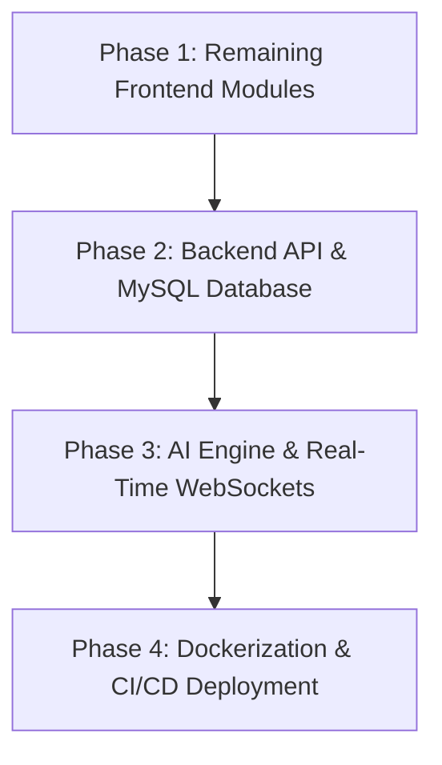

# Office Aid

### Enterprise Workplace Automation & Intelligent Management Platform

[](https://react.dev/)
[](https://vitejs.dev/)
[](https://tailwindcss.com/)
[](https://nodejs.org/)
[](https://expressjs.com/)
[](https://eslint.org/)

---

## 1. Executive Summary

**Office Aid** is an enterprise-grade workplace automation and management platform engineered to streamline corporate operations, project execution, team schedules, IT support, internal communications, and staff rosters. Built around an **Apple Liquid Glass UI design system**, Office Aid combines dual-theme (Dark/Light) glassmorphism aesthetics, responsive multi-view engines, and an integrated context-aware AI assistant.

---

## 2. System Architecture & Repository Structure

The project is architected as a scalable **Full-Stack Monorepo**:

```text
Office-Aid/
├── 🎨 frontend/                # React 19 + Vite 8 + Tailwind CSS v4 Client
│   ├── src/
│   │   ├── components/         # Core UI Library & Shared Components
│   │   │   ├── ui/             # GlassPanel, GlassCard, GlassButton, GlassTabs, etc.
│   │   │   ├── common/         # ThemeToggle, FloatingAiAssistant, Navigation Bars
│   │   │   └── layout/         # DashboardLayout, Sidebar, Navbar
│   │   ├── context/            # Decoupled React Context Objects (ThemeContext, AiAssistantContext)
│   │   ├── features/           # Modular Domain Features
│   │   │   ├── dashboard/      # Executive Greeting, Live Weather, Metrics, Department Chart
│   │   │   ├── projects/       # Portfolio Filtering, Project Cards, Create Modal
│   │   │   ├── tasks/          # Agile Kanban Command Center, Subtask Progress, Priorities
│   │   │   ├── meetings/       # Video Call Scheduler, Daily Timeline, Attendees
│   │   │   ├── employees/      # Staff Roster, Grid/Table/OrgChart Views, Add/Edit Modal
│   │   │   ├── emails/         # Internal Mail Client, Folders, AI Summarizer & Auto-Reply
│   │   │   ├── tickets/        # IT Helpdesk Queue, SLA Tracking, AI Resolution Assistant
│   │   │   ├── notifications/  # Workplace Notification Center, Category & Read Filters, Priority Alerts
│   │   │   ├── profile/        # Executive Identity, Performance Stats, Security Settings
│   │   │   └── error/          # Topographic 404 Error Page
│   │   ├── hooks/              # Custom React Hooks (useTheme, useAiAssistant)
│   │   ├── routes/             # AppRoutes Route Declarations
│   │   └── theme/              # Design System Tokens & Glass Specular Utilities
│   └── package.json
└── ⚡ backend/                 # API Service Layer (Node.js 22 + Express 5)
    ├── src/
    │   ├── config/             # Environment & Database Settings
    │   ├── controllers/        # REST API Controllers
    │   ├── routes/             # API Route Handlers
    │   └── server.js           # Server Entry Point
    └── package.json
```

---

## 3. Technology Stack Breakdown

### Current Implementation Stack

| Layer | Technology | Version | Purpose & Description |
| :--- | :--- | :--- | :--- |
| **Frontend Core** | **React** | `19.0.0` | Modern UI library leveraging Hooks & Concurrent Mode |
| **Build System** | **Vite** | `8.1.5` | Ultra-fast HMR dev server & Rolldown bundler |
| **Styling & Design** | **Tailwind CSS** | `4.0` | Utility-first CSS engine with custom Apple Liquid Glass variables |
| **Animation Engine** | **Framer Motion** | `12.0` | Physics-based spring animations, layout transitions & tab gliding |
| **Iconography** | **Lucide React** | `0.475.0` | Enterprise vector icon suite |
| **Client Routing** | **React Router DOM** | `7.1.5` | Single-page client routing & navigation |
| **Code Quality** | **ESLint** | `9.0` | Strict linting rules (0 warnings/errors across entire codebase) |
| **Server Runtime** | **Node.js** | `22.x` | Asynchronous JavaScript runtime environment |
| **Backend Web Framework** | **Express.js** | `5.0` | Modular ES Module RESTful API service framework |

---

### Future Integration Stack (Planned Architecture)

| Layer | Technology | Target Purpose |
| :--- | :--- | :--- |
| **Relational Database** | **MySQL 8.0** | Persistent storage for users, projects, tasks, meetings, emails, and tickets |
| **ORM / Query Engine** | **Prisma ORM / Sequelize** | Type-safe database queries, migrations, and schema modeling |
| **Authentication** | **JWT & Bcrypt** | Secure stateless token authentication, HTTP-only cookies, and password hashing |
| **Real-Time Engine** | **Socket.io / WebSockets** | Instant Kanban drag-and-drop sync, live online status, and push alerts |
| **AI LLM Backend** | **Google Gemini 1.5 Pro API** | Backend intelligence powering the AI Assistant with database tool calling & RAG |
| **Containerization** | **Docker & Docker Compose** | Isolated container environment for Frontend, Backend API, MySQL, and Nginx |
| **Reverse Proxy** | **Nginx** | SSL termination, load balancing, and static asset caching |
| **CI / CD** | **GitHub Actions** | Automated linting, build verification, and deployment pipelines |

---

## 4. Implemented Features & Modules

### 🎨 Apple Liquid Glass Design System & Dual Theme Engine
* **Glassmorphic Depth Layers**: Multi-level backdrop blurs, top-edge specular highlight reflections, radial ambient glow spots, and translucent surfaces.
* **Dual Theme Engine**: Seamless toggling between **Dark Mode** (deep slate backdrop) and **Light Mode** (crisp pure white `#ffffff` panels with slate typography `#0f172a`).
* **Custom Button Color Palette**:
  * **Dark Mode**: `.first-color` (`#fbfbfb`), `.second-color` (`#fff1c1`), `.third-color` (`#78b7bb`), `.fourth-color` (`#808b97`).
  * **Light Mode**: `.first-color` (`#827055`), `.second-color` (`#a79e8b`), `.third-color` (`#d4ceb0`), `.fourth-color` (`#ede7cf`).

---

### 📊 Executive Dashboard Module
* **Hero Greeting Banner (`Greeting.jsx`)**: Precise time-of-day salutation (*Good Morning ☀️, Good Afternoon 🌤️, Good Evening 🌆/🌙*) with live second-by-second ticker clock (`HH:MM:SS AM/PM`).
* **Precise Real-Time Weather Widget (`WeatherWidget.jsx`)**: Hyper-local weather monitor connected to the Open-Meteo API and browser Geolocation. Features real-time temperature, feels-like temp, humidity, wind speed, WMO condition codes, and automatic Day/Night icon switching (Sun vs. Moon).
* **Metrics Summary Grid (`StatsGrid.jsx`)**: Key performance indicators tracking Active Projects, Pending Tasks, Today's Syncs, Staff Count, and Open Tickets.
* **Department Distribution Chart (`DepartmentChart.jsx`)**: Visual breakdown of headcount across Engineering, Design, Product, Marketing, and HR.
* **Company Announcements (`Announcements.jsx`)**: Broadcast pinboard with category tags and author attributions.

---

### 📁 Projects Management Module
* **Project Control Bar (`FilterBar.jsx`)**: Real-time project search input (`⌘K`), status tabs (*All Projects, Active, Completed, On Hold*), sorting options (*Name, Due Date, Progress*), and "New Project" modal trigger.
* **Project Cards Grid (`ProjectCard.jsx` & `ProjectGrid.jsx`)**: Rich cards displaying project progress bars, assigned team avatars, due date countdowns, status badges, and contextual action menus.
* **Create Project Modal (`CreateProjectModal.jsx`)**: Interactive glass modal form for creating new projects.

---

### 📋 Task Command Center (Agile Kanban Board)
* **Tasks Control Bar (`TasksHeader.jsx`)**: Task search, column filter tabs (*All Tasks, To Do, In Progress, Review, Completed*), priority matrix dropdown (*Critical, High, Medium, Low*), and "New Task" trigger.
* **Kanban Board Layout (`TaskKanbanBoard.jsx`, `TaskColumn.jsx`, `TaskCard.jsx`)**: Multi-column board displaying task cards with subtask progress bars, priority badges, assignee avatars, and due date alerts.
* **Create Task Modal (`CreateTaskModal.jsx`)**: Form interface to add new tasks with priority and column assignments.

---

### 📅 Meetings & Schedule Module
* **Meetings Control Bar (`MeetingsHeader.jsx`)**: Search input, meeting status tabs (*All Meetings, Today, Upcoming, Completed*), and "Schedule Meeting" action button.
* **Meeting Cards & Grid (`MeetingCard.jsx` & `MeetingGrid.jsx`)**: Cards featuring platform badges (Google Meet, Zoom, Teams), room links, attendee avatar stacks, countdown badges, and join/cancel triggers.
* **Schedule Meeting Modal (`ScheduleMeetingModal.jsx`)**: Modal interface to schedule syncs with time slot pickers, host selection, and participant selectors.
* **Daily Timeline (`DailyTimeline.jsx`) & Upcoming Syncs (`UpcomingMeetings.jsx`)**: Hour-by-hour operational schedule view and quick event listing widget.

---

### 👤 Executive Profile Module
* **Identity Banner (`ProfileHeader.jsx`)**: Profile avatar with status ring indicator, role badge, department, location, and theme switcher.
* **Performance Overview (`ProfileStats.jsx`)**: Personal accomplishment metrics and activity stats.
* **Recent Activity Stream (`RecentActivity.jsx`)**: Audit log timeline of user actions.
* **Security Settings (`ProfileSecurity.jsx`)**: Password management, 2FA status, and active session controls.

---

### 👥 Employee Directory & Talent Hub Module
* **Summary Metrics Bar (`EmployeeStatsWidget.jsx`)**: Headcount stats, active engagement rate, busy status counters, average performance score, and top department breakdown.
* **Directory Control Bar (`EmployeesHeader.jsx`)**: Spotlight search (`⌘K`), department tabs (*All Staff, Executive, Engineering, Design, Product, Marketing, HR*), presence status filter dropdown, and layout switcher.
* **Multi-View Engine**:
  * **Grid View (`EmployeeGrid.jsx` & `EmployeeCard.jsx`)**: Glass cards with status avatars, contact links, skill tag clouds, assigned project counts, performance ratings, and message/edit buttons.
  * **Table View (`EmployeeTable.jsx`)**: Data table format displaying metadata, role tiers, department tags, and action triggers.
  * **Org Chart Hierarchy (`OrgChart.jsx`)**: Visual tree diagram mapping Executive Leadership -> Department Leads -> Team Specialists.
* **Add / Edit Employee Modal (`AddEmployeeModal.jsx`)**: Interactive glass modal form to add or edit employee records.

---

### 📧 Internal Mail & Communications Module
* **Control Bar (`EmailsHeader.jsx`)**: Spotlight search bar (`⌘K`), category dropdown (*Announcements, Project Sync, HR Memos, IT Alerts, Meeting Minutes*), and "+ Compose Email" CTA.
* **Folder Navigation Sidebar (`EmailSidebar.jsx`)**: Folder menu (*Inbox, Starred, Sent, Drafts, Trash*) with unread count badges.
* **Message List (`EmailList.jsx`)**: Email thread items featuring sender avatars, subject lines, snippet previews, category badges, timestamps, and star toggles.
* **Detail Reading Pane (`EmailDetailView.jsx`)**: Message body display with **✨ AI Thread Summarizer** (one-click bullet takeaways) and **✨ AI Auto-Reply Drafter**.
* **Compose Modal (`ComposeEmailModal.jsx`)**: Glass modal form for drafting and sending emails with **✨ AI Template Drafting**.

---

### 🎫 IT Helpdesk & Support Tickets Module
* **Summary Metrics Bar (`TicketStatsWidget.jsx`)**: Real-time helpdesk queue counters (*Total Tickets, Open Issues, In Progress, Critical Escalations*).
* **Control Bar (`TicketsHeader.jsx`)**: Spotlight search bar (`⌘K`), category tabs (*Access & Security, IT Infrastructure, Software & Tools, Facilities, HR Ops*), priority dropdown (*Critical, High, Medium, Low*), and "+ Submit Ticket" CTA.
* **Multi-View Engine**:
  * **List View (`TicketList.jsx` & `TicketCard.jsx`)**: Glass cards with ticket IDs, requester/assignee avatars, priority badges, SLA countdown timers, and quick resolve actions.
  * **Helpdesk Kanban Board (`TicketKanban.jsx`)**: Multi-column board categorizing tickets into *Open Queue*, *In Progress*, *Under Review*, and *Resolved*.
* **Ticket Detail Timeline Modal (`TicketDetailModal.jsx`)**: Full issue description, requester info, status switcher, comment stream, and **✨ AI Resolution Assistant**.
* **Submit Ticket Modal (`CreateTicketModal.jsx`)**: Glass modal form to log support tickets with priority tier selection.

---

### 🔔 Workplace Notifications Center Module
* **Summary Metrics Bar (`NotificationStatsWidget.jsx`)**: Real-time notification counters (*Total Alerts, Unread Notifications, Urgent/High Priority, Acknowledged Alerts*).
* **Control Bar (`NotificationsHeader.jsx`)**: Spotlight search (`⌘K`), category tabs (*All Categories, Tasks, Meetings, Emails, Tickets, System*), read status switcher (*All, Unread, Read*), priority dropdown (*Urgent, High, Normal, Low*), and global CTAs (*Mark All as Read, Clear All*).
* **Interactive Notification Cards (`NotificationCard.jsx` & `NotificationList.jsx`)**: Apple Liquid Glass cards with category icons, animated unread glow indicators, sender avatars, priority badges, action links, read toggle buttons, and Framer Motion layout transitions.

---

### 🤖 Intelligent AI Assistant Platform
* **Slide-out Glass Drawer (`FloatingAiAssistant.jsx`)**: Floating action button that opens an AI assistant sidebar accessible across all pages.
* **Features**: Contextual prompt chips (*Summarize Tasks, Draft Email, Meeting Notes, Project Risks*), message bubble formatting, code block copying, and message history streaming.

---

### 🚫 Custom 404 Error Page
* **Topographic Organic Wave Styling (`NotFound.jsx`)**: Dark matte background overlay with topographic SVG contour curves, massive serif `404` typography, elegant subtitle, and system primary theme `RETURN TO HOME` CTA button.
* **Route Interception (`AppRoutes.jsx`)**: Intercepts all invalid or unhandled URLs and presents the 404 page.

---

### 🧩 Core Component Library (`src/components/ui`)
- `GlassPanel`: Glass container with specular lighting and depth variants (*default, floating, inset, bordered*).
- `GlassCard`: Card component with hover lift animations and glow accents (*blue, cyan, purple, white*).
- `GlassButton`: Button with size presets (*sm, md, lg, xl, icon*), variant colors (*primary, secondary, third, fourth, ghost, danger*), and icons.
- `GlassInput` & `GlassTextarea`: Styled form inputs with focus glow states and character counters.
- `GlassSearchBar`: Spotlight-style search bar with shortcut key pill (`⌘K`) and clear button.
- `GlassTabs`: Segmented tab bar with a smooth gliding liquid pill indicator.
- `GlassDropdown`: Dropdown menu with keyboard accessibility and specular borders.
- `GlassModal`: Dialog modal with backdrop blur, specular header, and escape key listener.
- `GlassBadge`: Pill badge with variant themes (*cyan, blue, purple, success, warning, danger*).
- `GlassAvatar`: User avatar with status indicator rings (*online, away, busy, offline*) and initials fallback.
- `GlassTable`: Data table wrapper with glass rows, column headers, and action cells.
- `GlassNavbar` & `GlassSidebar`: Navigation components for application routing.

---

## 5. Future Development Roadmap



### Phase 1: Remaining Frontend Modules
- **Settings & Role-Based Access Control (RBAC)**:
  - System preference configuration panel (*General, Security, Notifications, API Keys*).
  - Fine-grained RBAC permission matrix (*Admin, Manager, Employee, Guest*).

---

### Phase 2: Backend API & Relational Database
- **Express REST API Service**:
  - Endpoints for Auth, Projects, Tasks, Meetings, Employees, Emails, Tickets, and Users.
  - Payload validation using Zod / Joi schemas.
- **MySQL Database Persistence**:
  - Relational database schema with foreign key constraints, indexes, and connection pooling.
  - Database migrations for all feature entities.
- **Authentication & Security**:
  - JWT stateless authentication, HTTP-only cookie management, and refresh token rotation.
  - Password hashing with `bcrypt` and password reset flows.

---

### Phase 3: AI Engine Backend & Real-Time Sync
- **LLM API Backend Integration**:
  - Direct integration with Google Gemini 1.5 Pro API for the AI Assistant drawer.
  - Function calling and Retrieval-Augmented Generation (RAG) querying real workspace database records.
- **WebSocket Synchronization (Socket.io)**:
  - Real-time drag-and-drop Kanban updates across connected user sessions.
  - Instant meeting notifications and live staff online presence.

---

### Phase 4: Containerization & CI/CD Deployment
- **Dockerization**:
  - Multi-stage `Dockerfile` for production Vite build & Express server process.
  - `docker-compose.yml` orchestrating Frontend, Backend, MySQL, and Nginx containers.
- **CI/CD Pipeline**:
  - GitHub Actions workflows for automated ESLint checks, unit testing, and deployment to production servers.

---

## 6. Installation & Local Setup Guide

### 1. Prerequisites
- **Node.js**: v18.0.0 or higher (v22 recommended)
- **npm**: v9.0.0 or higher

### 2. Frontend Setup
```bash
cd frontend
npm install
npm run dev
```
> The Vite development server will launch at `http://localhost:5173/` (or `http://localhost:5174/`).

### 3. Backend Setup
```bash
cd backend
npm install
npm run dev
```
> The Express server will watch for changes and run at `http://localhost:5000/`.

---

## 7. Verification & Production Build

To run ESLint code quality checks and verify production build compilation:

```bash
# Execute ESLint
cd frontend
npm run lint

# Execute Production Build
npm run build
```

---

<div align="center">

**Office Aid Platform** • Designed & Developed by **Sourasish Ghosh**

</div>
